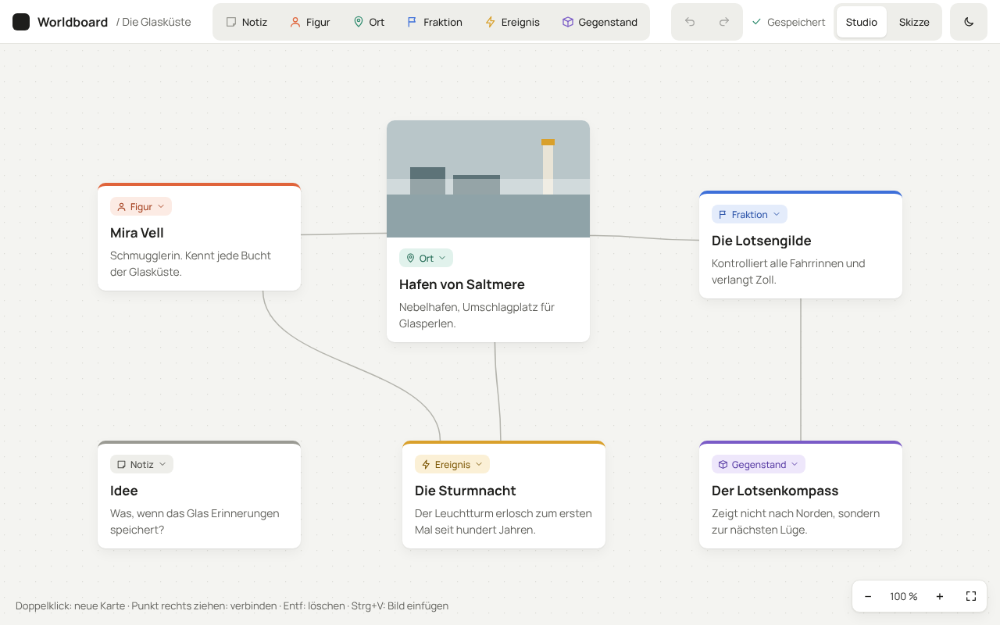
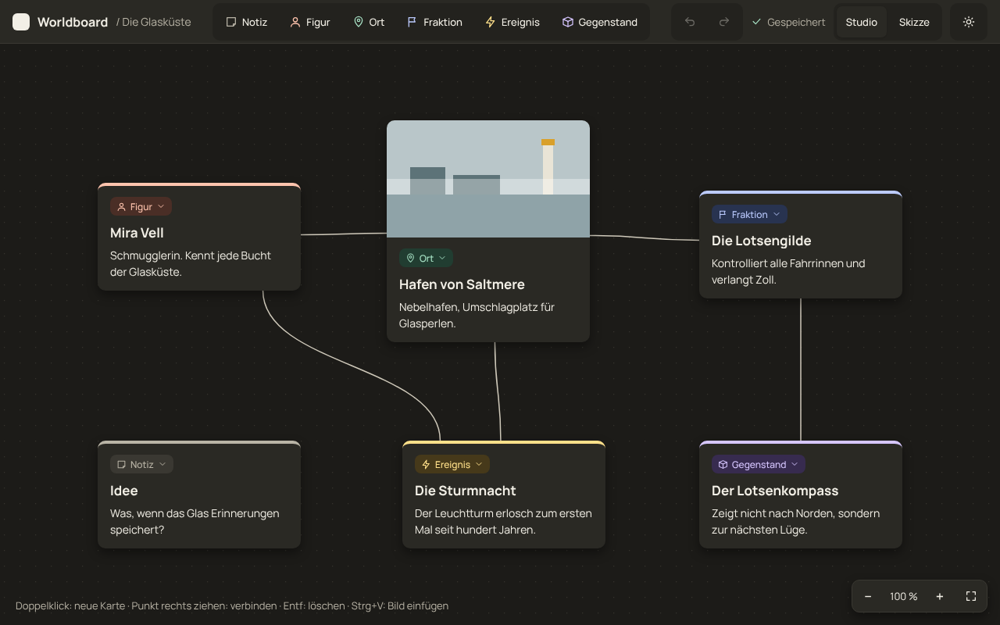
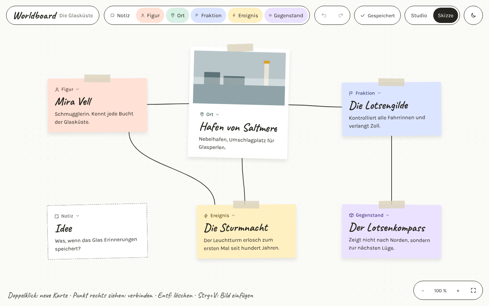
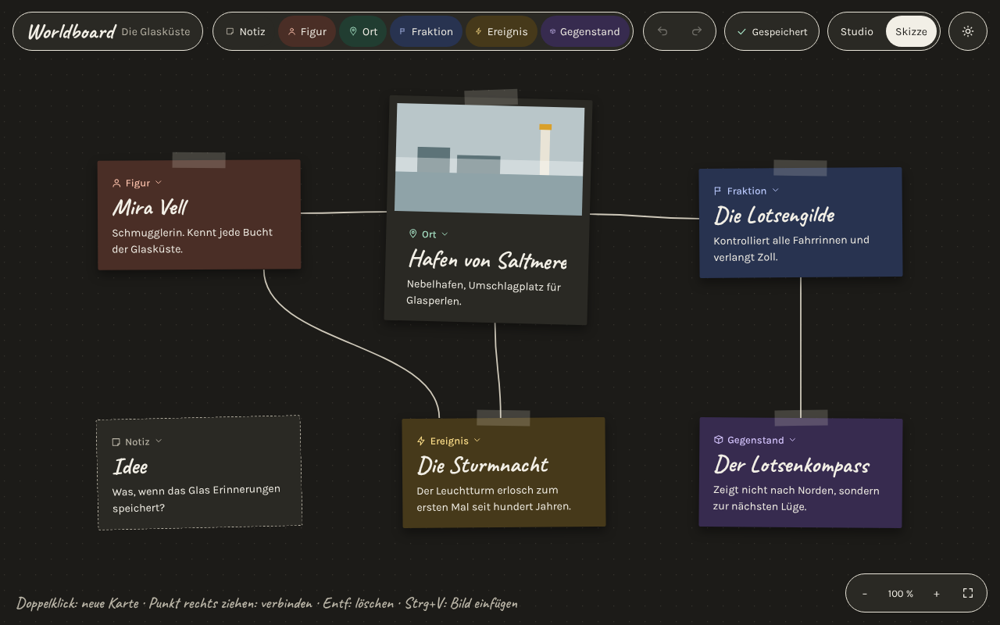

# Worldboard

Eine persönliche Leinwand für Worldbuilding und Moodboards: Figuren, Orte, Fraktionen,
Ereignisse, Gegenstände und Notizen als Karten anlegen, Bilder hineinziehen und alles
miteinander verbinden. Plan, Roadmap und Architektur stehen in [PLAN.md](PLAN.md).

| Studio · Tag | Studio · Nacht |
|---|---|
|  |  |
| **Skizze · Tag** | **Skizze · Nacht** |
|  |  |

## Starten

### Als Desktop-App (für echte Welten)

Voraussetzungen: [Node.js](https://nodejs.org) 20 oder neuer und die
[Tauri-Voraussetzungen](https://tauri.app/start/prerequisites/) (Rust; unter macOS die Xcode Command Line Tools).

```bash
cd worldboard
npm install
npm run desktop
```

Der erste Start kompiliert die App und dauert ein paar Minuten, danach geht es schnell.
Eine fertige App zum Installieren baust du mit `npm run tauri build`.

### Im Browser (zum Ausprobieren)

```bash
npm run dev
```

Dann <http://localhost:1420> öffnen. Die Daten liegen hier nur im Browser-Speicher.

## Wo liegt meine Welt?

In der Desktop-App im Ordner **Dokumente/Worldboard**:

```
Worldboard/
├── world.json   die Welt als lesbare Textdatei
├── assets/      alle Bilder, benannt nach ihrem Inhalt
└── backups/     eine Sicherung pro Tag, die letzten 14 bleiben erhalten
```

Den ganzen Ordner kannst du kopieren, um deine Welt zu sichern oder umzuziehen.
Geht `world.json` kaputt, startet die App nicht mit einer leeren Welt, sondern zeigt
einen Hinweis. Dann kopierst du die neueste Datei aus `backups/` zurück nach `world.json`.

## Bedienung

| Aktion | So geht's |
|---|---|
| Neue Karte | Doppelklick auf die Leinwand oder Typ oben in der Leiste wählen |
| Kartentyp ändern | Auf die Typ-Plakette in der Karte klicken |
| Bild hinzufügen | Bild auf eine Karte ziehen oder mit Strg+V einfügen (in die Karte, in der du schreibst oder die ausgewählt ist, sonst als neue Karte) |
| Verbinden | Punkt rechts an der Karte auf eine andere Karte ziehen |
| Breite ändern | Karte anklicken, Griff unten rechts ziehen |
| Löschen | Karte oder Linie anklicken, dann Entf |
| Rückgängig / Wiederholen | Strg+Z / Strg+Umschalt+Z (oder Strg+Y), auf dem Mac mit Cmd, oder die Pfeile oben |
| Stil und Modus | Oben rechts: Studio/Skizze und Sonne/Mond |

Alles wird automatisch gespeichert, auch beim Schließen des Fensters.

## Entwickeln

```bash
npm test            # Unit-Tests für Core und Speicher (Vitest)
npm run test:e2e    # Browser-Tests (Playwright), startet den Dev-Server selbst
npm run build       # Typprüfung und Produktions-Build

SCREENSHOTS=1 npm run test:e2e -- screenshots   # Screenshots in docs/ neu erzeugen
```
